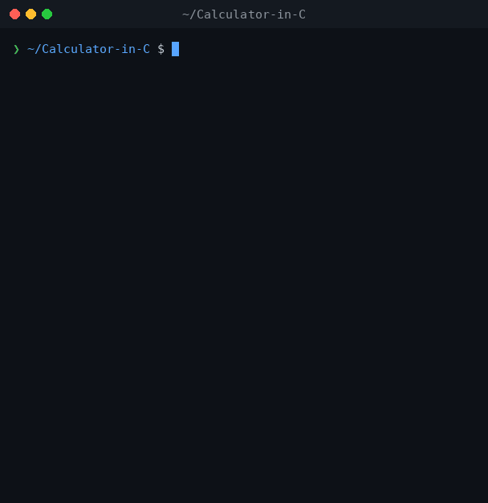

# 🧮 Calculator in C

  
  

O **Calculator.c** é uma aplicação de Interface de Linha de Comando (CLI) desenvolvida em C que realiza operações aritméticas fundamentais. Este projeto serve como uma implementação prática de programação modular, gerenciamento de fluxo de controle e operações padrão de entrada/saída (I/O).

## 🎬 Demonstração

  

## 🚀 Funcionalidades

- **Operações Aritméticas:** Suporta operações de adição, subtração, multiplicação e divisão.
- **Tratamento de Erros:** Implementa lógica condicional para lidar adequadamente e prevenir erros de divisão por zero.
- **Gerenciamento de Estado:** Utiliza laços while aninhados para manter o estado da aplicação, permitindo que os usuários realizem múltiplos cálculos contínuos sem o encerramento abrupto do processo.
- **Menu Interativo:** Fornece um sistema de menu claro e amigável para a seleção de operações e controle de execução do programa.

## 🛠️ Arquitetura Técnica

- **Linguagem:** C.
- **Design Modular:** Cada operação matemática é encapsulada em sua própria função dedicada (`addition`, `subtraction`, `multiplication`, `division`), retornando um valor de ponto flutuante de dupla precisão (`double`).
- **Processamento de Entrada:** Lida com entradas numéricas (`%lf`, `%d`) e comandos de controle baseados em caracteres (`y/n`). Utiliza formatação de espaço na função `scanf` para gerenciar o buffer de entrada de forma eficaz e validar as respostas do usuário.
